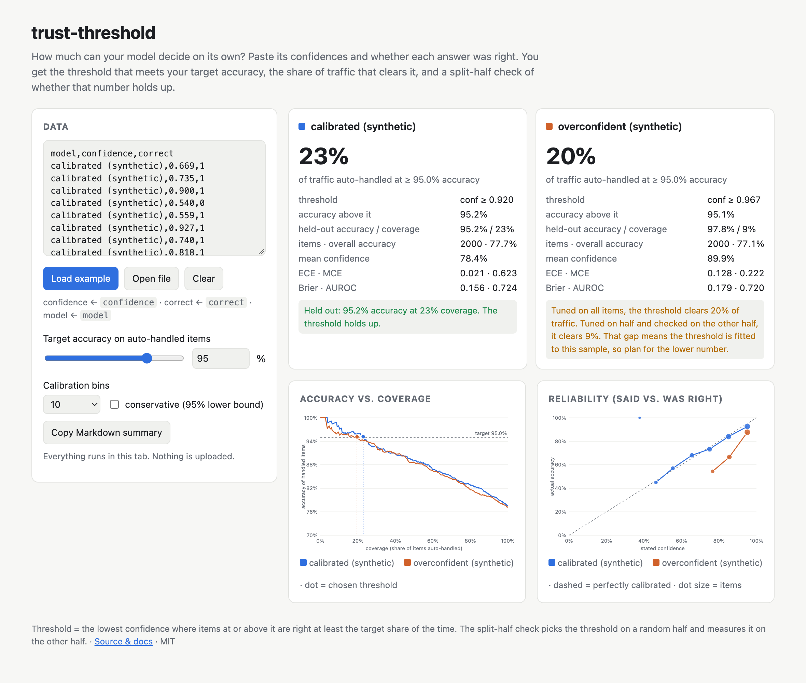

# trust-threshold

**How much can your model decide on its own?** Paste its confidences and whether each answer was right. You get the threshold that meets your target accuracy, the share of traffic that clears it, calibration error, and a split-half check that shows whether the number holds up on data it wasn't tuned on.

[](https://thinx-pro.github.io/trust-threshold/)   



<sub>Screenshot: the built-in **synthetic** example (one calibrated model, one overconfident model), not real model results.</sub>

## Why

Decision models and LLM routers now return a confidence with every answer. Whether you can rely on that number is the deciding question when you ship one:

- *"At 95% accuracy, how much traffic can I auto-handle, and how much goes to a human?"* A recent r/LLMDevs comparison framed it exactly this way: a calibrated model could auto-handle 43% of traffic at 95% accuracy, while its uncalibrated base model managed 16%.
- Vendor leaderboards report accuracy. They don't report the **coverage you get at your own accuracy bar on your own data**.
- A threshold picked on the same set you report results on flatters itself. That comparison was itself criticised for setting its threshold on the eval set. That's why this tool always shows a held-out number next to the in-sample one.

## Quick start

1. Open **https://thinx-pro.github.io/trust-threshold/**
2. Paste a CSV / JSON / JSONL with a confidence column and a correct column (or drop a file onto the page)
3. Move the target accuracy slider

To run it locally instead: `git clone` the repo, then `python3 -m http.server` in its folder. There's no build step.

### Input formats

```csv
model,confidence,correct
my-router-v2,0.97,1
my-router-v2,0.61,0
baseline,92%,true
```

- **confidence** column: `confidence`, `conf`, `probability`, `prob`, `p` or `score`. Values can be 0–1 or 0–100 (`%` allowed).
- **correct** column: `correct`, `is_correct`, `hit` or `ok`, with `1/0`, `true/false` or `yes/no`. You can also give **prediction + label** columns (`prediction`/`pred`/`answer` and `label`/`gold`/`expected`), and correct means the two are equal.
- An optional **model** column compares up to 4 models on the same charts.
- A header is optional. Without one, column 1 is read as confidence and column 2 as correct.

## What it computes

| Output | Meaning |
|---|---|
| **Auto-handled %** | Coverage at the lowest confidence threshold where accepted items meet the target accuracy |
| **Held-out accuracy / coverage** | The threshold is chosen on a random half and measured on the other half (seeded, reproducible). It's flagged if the held-out accuracy misses the target, or if coverage drops sharply |
| **Conservative mode** | Requires the 95% Wilson lower bound of accepted accuracy to meet the target, instead of the point estimate |
| **ECE / MCE** | Expected and maximum calibration error over equal-width bins (5 / 10 / 15 / 20) |
| **Brier, AUROC** | Overall probability error, and how well confidence ranks right answers above wrong ones |
| **Charts** | Accuracy–coverage curve with your target line, and a reliability diagram (dot size = items per bin) |
| **Copy Markdown** | A summary table to paste into a PR or doc |

Items with tied confidence are accepted or rejected together, so the threshold is always one you could actually deploy.

## Limitations

- Binary correctness only. Graded scores and cost-weighted errors aren't supported yet.
- Small samples make thresholds near 100% unstable. The page warns below 200 items, but a few hundred is still small for a 99% target.
- One random split. Repeated splits and bootstrap intervals are on the roadmap.
- Calibrating the model itself (temperature / isotonic fitting) is out of scope. This tool measures; it doesn't fix.

Roadmap: bootstrap confidence bands, per-slice breakdown (e.g. by task type), and cost-weighted thresholds ("a wrong auto-answer costs 20× a human review").

## Development

```bash
npm test        # node:test on calib.js (parsing, ECE, AUROC, Wilson bound, thresholds, split-half)
npm run serve   # http://localhost:8765
```

All logic lives in [`calib.js`](calib.js) (pure functions, no DOM). [`app.js`](app.js) draws the page with plain SVG. There are no dependencies and no external requests.

## License

MIT

If this saved you a spreadsheet, a ⭐ helps others find it.
